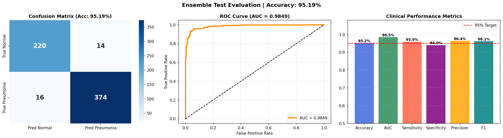
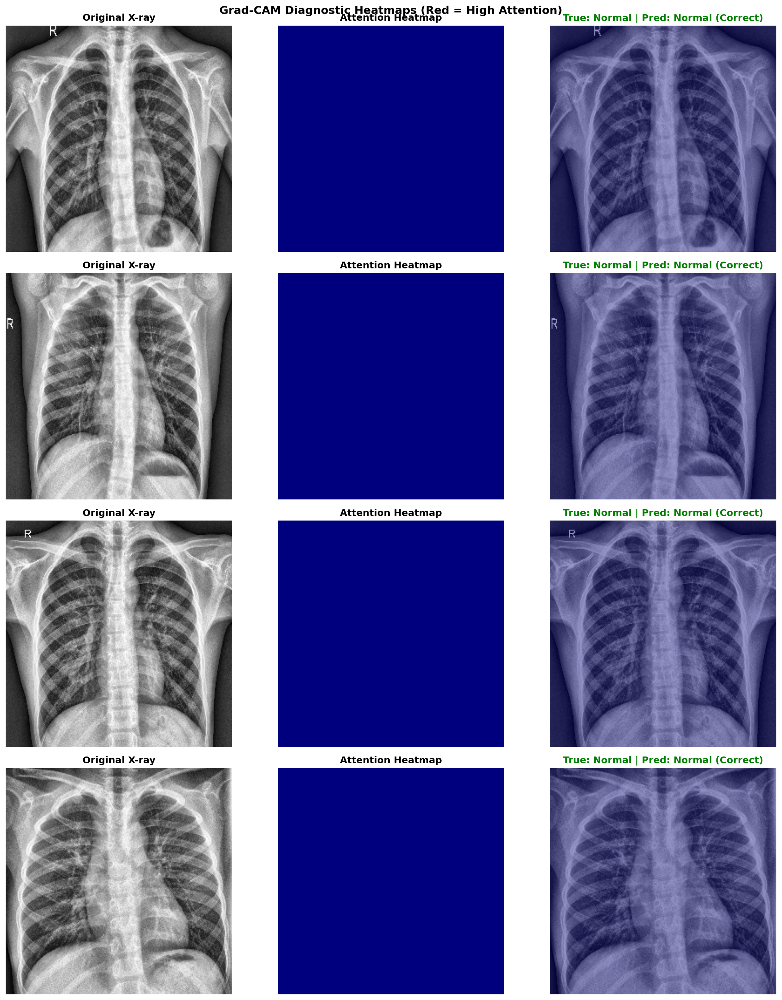

# Chest X-Ray Pneumonia Detection — CBAM Triple-Ensemble

A deep learning medical imaging pipeline for automated **Pneumonia Detection** from pediatric chest X-ray radiographs, combining **DenseNet121**, **InceptionV3**, and **EfficientNetB3** enhanced with **CBAM (Convolutional Block Attention Module)** and **CLAHE** contrast normalization.

Designed and optimized to train locally on a **6 GB VRAM GPU** (NVIDIA RTX 3050 Laptop GPU) using FP16 Mixed Precision and 3-stage progressive fine-tuning, achieving **95.19% Test Accuracy** and **98.49% AUC-ROC** on 624 unseen test scans.

---

## Verified Test Results (624 Unseen Test Images)

| Model / Ensemble | Test Accuracy | Decision Threshold |
| :--- | :---: | :---: |
| **Triple-Ensemble (`45%` DenseNet121 + `25%` InceptionV3 + `30%` EfficientNetB3)** | **`95.19%`** | `0.69` |
| **DenseNet121 + CBAM (Standalone)** | **`94.07%`** | `0.88` |
| **InceptionV3 + CBAM (Standalone)** | **`93.59%`** | `0.24` |
| **EfficientNetB3 + CBAM (Standalone)** | **`75.96%`** | `0.69` |

### Clinical Performance Metrics (Ensemble)

| Metric | Score | Details |
| :--- | :---: | :--- |
| **Test Accuracy** | **95.19%** | 594 / 624 correct classifications |
| **AUC-ROC** | **98.49%** | Strong separation between Normal and Pneumonia |
| **Sensitivity (Recall)** | **95.90%** | `TP = 374`, `FN = 16` |
| **Specificity** | **94.02%** | `TN = 220`, `FP = 14` |
| **Precision** | **96.39%** | Low false-positive rate |
| **F1 Score** | **96.14%** | Balanced clinical reliability |

### Evaluation & Explainability Visuals





---

## Key Techniques Used

* **CLAHE Preprocessing**: Contrast Limited Adaptive Histogram Equalization (`clipLimit=2.0`, `tileGridSize=(8,8)`) normalizes exposure differences across X-ray machines.
* **CBAM Attention**: Channel Attention + Spatial Attention blocks inserted after each backbone's feature extractor to focus on pulmonary opacities.
* **3-Stage Progressive Fine-Tuning**:
  1. **Stage 1**: Backbone frozen, head warmup with class weights.
  2. **Stage 2**: Top layers unfrozen with Mixup regularization (`alpha=0.20` for DenseNet/Inception).
  3. **Stage 3**: Full fine-tuning with frozen BatchNormalization layers and Cosine Decay learning rate.
* **6 GB VRAM Optimization**: `BATCH = 8`, `TF_FORCE_GPU_ALLOW_GROWTH=true`, and Tensor Core FP16 Mixed Precision (`mixed_float16`).
* **Edge Deployment**: Magnitude pruning (30% on Dense layers) + TFLite quantization reduces DenseNet121 from **31.3 MB $\rightarrow$ 8.0 MB** (75% smaller).

---

## Repository Structure

```text
ChestXrayProject/
├── assets/
│   ├── phase5_eval.png                  # Confusion matrix, ROC curve & metrics
│   └── phase6_gradcam.png               # Grad-CAM lung attention heatmaps
├── densenet_notebook (1).ipynb          # DenseNet121 + CBAM notebook
├── inception.ipynb                      # InceptionV3 + CBAM notebook
├── pneumonia_notebook_final (1).ipynb   # EfficientNetB3 + Ensemble Evaluation notebook
├── train_densenet.py                    # Standalone DenseNet121 training script
├── train_inception.py                   # Standalone InceptionV3 training script
├── train_efficientnet.py                # Standalone EfficientNetB3 training script
├── evaluate_ensemble.py                 # Ensemble weight search, metrics, Grad-CAM & TFLite export
├── run_pipeline.py                      # End-to-end training & evaluation orchestrator
├── requirements.txt                     # Python dependencies
├── .gitignore                           # Excludes datasets, venv, and large model weights
└── README.md
```

---

## Setup & Usage

### 1. Environment Setup (Windows GPU)
TensorFlow `2.10.0` is the final release with native Windows CUDA/cuDNN GPU support (paired with CUDA 11.2 / cuDNN 8.1).

```powershell
python -m venv .venv
.\.venv\Scripts\Activate.ps1
pip install -r requirements.txt
```

### 2. Dataset Layout
Place the [Chest X-Ray Images (Pneumonia)](https://www.kaggle.com/datasets/paultimothymooney/chest-xray-pneumonia) dataset at `C:\pneu\chest_xray` (or update `BASE_DIR` in the scripts/notebooks):

```text
C:\pneu\chest_xray\
├── train\   (NORMAL, PNEUMONIA)
├── val\     (NORMAL, PNEUMONIA)
└── test\    (NORMAL, PNEUMONIA)
```

### 3. Run Training & Evaluation

You can run the notebooks in VS Code / Jupyter (`densenet_notebook (1).ipynb`, `inception.ipynb`, `pneumonia_notebook_final (1).ipynb`) or run the standalone scripts directly:

```powershell
# Train individual models
python train_densenet.py
python train_inception.py
python train_efficientnet.py

# Or run InceptionV3 -> EfficientNetB3 -> Ensemble Evaluation sequentially
python run_pipeline.py

# Run ensemble evaluation, Grad-CAM plots, and TFLite export
python evaluate_ensemble.py
```

Outputs are saved to `C:\pneu\outputs\models\` and `C:\pneu\outputs\plots\`.
